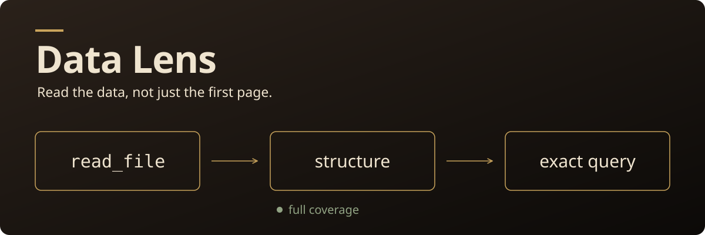

# Data Lens



A Hermes plugin that turns the *first default `read_file` of a large local CSV / JSON / JSONL file* into a
typed **structural map** computed over **all** records, and adds two read-only tools for **exact, bounded**
filtering and grouping (`data_lens_profile`, `data_lens_query`).

Pure Python standard library. No network, no model calls, no SQL, no `eval`, no background workers,
no state on disk. Requires Hermes `>=0.23.0`, POSIX host.

## What it does (and does not)

1. You enable it and explicitly list host directories (`roots`). **Default: no roots, nothing is readable.**
2. When the agent calls `read_file(path)` with no `offset`/`limit` on a large `.csv`, `.json` (top-level array of
   objects), `.jsonl` or `.ndjson` inside a root, the built-in handler runs first and reads the file. If that read
   was a successful *partial* page, Data Lens re-reads the file once (bounded) and returns a map instead of the raw page:
   format, fingerprint, exact record count, per-field types, missing/null counts, numeric min/max.
3. The agent then calls `data_lens_query` to group/aggregate/filter over every record. Sums are exact `Decimal`s.

**Honest scope.** This reduces *context payload*, not I/O: the base `read_file` still reads the file, and Data Lens does a
second bounded read. A map can be **larger** than the default page (see the minified-JSON row below). Everything else
(other file types, small files, explicit pagination, errors, binary, dedup stubs, relative/out-of-root paths, remote
backends, unsupported or invalid files, any plugin-side exception) returns the built-in result **unchanged**.

## Install and configure

Install directly from the Git URL, then enable the plugin and explicitly opt into local reads.
Replace `/abs/path/to/data` with a directory you intend to allow. Set `host_local` only when
file tools run on this same machine.

```bash
hermes plugins install https://github.com/itsolaph/data-lens.git
hermes plugins enable data-lens
hermes config set plugins.entries.data-lens.settings.roots '["/abs/path/to/data"]'
hermes config set plugins.entries.data-lens.settings.host_local true
```

For a local checkout, the existing manual installation is also available:

```bash
# Run from the parent directory of the data-lens checkout; preserve an active profile's home.
export HERMES_HOME="${HERMES_HOME:-$HOME/.hermes}"
mkdir -p "$HERMES_HOME/plugins"
cp -r data-lens "$HERMES_HOME/plugins/data-lens"
hermes plugins enable data-lens
hermes config set plugins.entries.data-lens.settings.roots '["/abs/path/to/data"]'
hermes config set plugins.entries.data-lens.settings.host_local true   # only if file tools run on THIS machine
```

| setting (`plugins.entries.data-lens.settings.*`) | default | meaning |
|---|---|---|
| `roots` | `[]` | absolute directories that may be read; `/` is rejected |
| `host_local` | `false` | must be `true`; set only for the local terminal backend (Docker/SSH/remote paths are never assumed local; `TERMINAL_ENV` / `terminal.backend` other than `local` also disable it) |
| `intercept_read_file` | `true` | `false` keeps the tools but never rewrites `read_file` |
| `limits.<name>` | see below | validated; values above the hard ceiling are clamped, invalid values ignored |

Limits (default / hard ceiling): `max_bytes` 16 MiB / 16 MiB, `max_rows` 200k / 1M, `max_line_bytes` 1 MiB / 1 MiB (JSONL line,
CSV record, JSON element), `max_columns` 256 / 1024, `max_depth` 16 / 32, `max_groups` 1000 / 10k, `max_group_fields` 4 / 8,
`max_projected` 16 / 64, `max_aggregates` 8 / 32, `max_filters` 16 / 64, `max_in_values` 50 / 500, `max_result_rows` 50 / 500,
`max_output_chars` 20k / 100k (minimum 1024; smaller positive settings are raised to 1024), `max_cell_chars` 200 / 2000, `time_limit_s` 15 / 60, `min_bytes` (interception threshold) 64 KiB.
Example: `hermes config set plugins.entries.data-lens.settings.limits.max_rows 50000`.

The manifest declares **no capabilities**: Hermes defines none for tool registration or middleware, and the plugin overrides no
built-in tool. Both tools register under the existing public `file` toolset, so file-only sessions can retrieve mapped data (Hermes may expose plugin tools through its tool-search bridge). No slash command is registered. After opting into `host_local` and roots, these custom tools grant additional bounded host-file reads independently of the built-in reader. `provides_tools` and `provides_middleware` match the registrations (`hermes plugins validate` checks this).

### Getting the raw lines back

Any explicit `offset` or `limit` disables the map for that call, e.g. `read_file(path, offset=1, limit=200)`. Avoid repeating the
*exact* default call: Hermes answers repeats with its own "unchanged" stub. `intercept_read_file: false` disables the rewrite globally.

## Semantics (all enforced in code and tests)

* **Formats.** CSV: UTF-8 (BOM ok), comma, header row, unique non-empty names; longer-than-header rows are refused, shorter rows
  counted as `short_rows` (missing). JSON: top-level array of objects only; wrapper objects, arrays of non-objects and duplicate keys
  are refused (`unsupported_json_shape` / `invalid_json`), never guessed or flattened. JSONL: one object per non-blank line;
  a malformed line is **refused** (not skipped) with its line number; blank lines are counted.
* **Exactness.** Any bound that would stop a scan (rows, bytes, line, columns, depth, groups, time) is an error; totals are
  never labelled exact after a partial scan. Results say `"coverage":"full"`. Output omissions are separate: a profile with omitted fields says `schema_complete:false`, `scan_exact:true`, `exact:false`, and gives an omitted count (no omitted-name list). The complete serialized tool/map envelope and errors obey the character cap; metadata that cannot fit is refused.
* **Types.** `null` = JSON null or empty CSV cell; `missing` = key absent. JSON numbers and strictly numeric CSV cells are numbers;
  a JSON *string* that is a strict number is `numeric_string` (usable numerically, counted in `accounting`); **booleans are never numeric**.
  Numeric tokens: <=64 chars, <=40 digits, decimal exponent within +/-100; larger ones are refused before any arithmetic.
* **Aggregates** `count|sum|min|max|mean`. `sum` is exact (Decimal over the original text, rounding trapped). `mean` = sum/n rounded to 28
  significant digits, half-even. Decimals are returned as plain-notation strings with the scale of the inputs (no exponent). Nulls/missing are
  skipped and counted; non-numeric values **fail the call** (`invalid_numeric_value`) unless `on_invalid:"skip"`, which counts them. Nothing is coerced to 0.
  An aggregate with no usable value is `null`.
* **Filters** (ANDed): operand type decides comparison (number exact / string by code point / bool / null). Values of another type or null never match and are
  counted per filter. Use `"as":"number"` with a decimal string for exact operands.
* **Groups** key on canonical plain text with scale preserved (`1.0` != `1.00`; JSON numbers `1E+2` and `100` share a group; CSV cells keep raw text so `007` != `7`); null and missing share a group; **no currency conversion** —
  group by `fee_currency`. Default order: key ascending (null < boolean < number < string). Explicit `order_by` on a group field or aggregate alias puts nulls last in both directions, with default key order breaking ties before offset/limit.
* **Distinct.** Typed scalar keys are compared exactly (hash collisions cannot merge values); numeric scale is preserved (`1.0` != `1.00`), as for groups. Null/object/array values are excluded. Counts become `null` with `distinct_capped:true` above 1000 keys or for a scalar longer than 2000 characters.
* **Fingerprint.** `sha256:<hex>` of the bytes. Pass it as `expect_fingerprint`; if the file changed you get `fingerprint_mismatch`, never stale data.
* Field names and values are **untrusted data**, never instructions. Output is ASCII-escaped JSON.

## Security model

Every read (middleware, profile, query) independently enforces: non-empty `roots`; `host_local`; absolute path; resolved containment
(symlink escapes rejected); regular files only (devices, FIFOs, sockets refused without opening a FIFO); extension allowlist (also for symlink targets);
protected names/dirs (`.env*`, `auth.json`, `*.pem`/`*.key`, `id_*`, names containing secret/credential/password, `.ssh`, `.aws`, `.git`, …), `/proc` `/sys` `/dev`,
the Hermes home and the plugin directory — even under a wide root; credential-looking content (PEM, cloud/GitHub/Slack key patterns) or credential-like
field names (`password`, `api_key`, …) refuse the file. One `O_NOFOLLOW` open, one bounded read, size/mtime/inode re-check and a re-resolve afterwards;
all parsing runs on that in-memory snapshot, so a file changed during a scan cannot yield a mixed answer.
The middleware calls `next_call(args)` exactly once, first, so the built-in handler's own denylist/binary/device/dedup logic decides before the plugin looks at anything; the plugin never reads a file the built-in read failed on.

Limits of this model (please read): it is **policy, not OS containment** — a hostile process that rewrites directories concurrently can beat any check-then-open scheme;
returned cells are **not** passed through Hermes' general secret redaction (only the refusals above apply); a plugin that reads files is itself a read privilege you grant by adding `roots`;
POSIX only; the second read costs I/O and CPU (bounded by the limits above). Time budgets are cooperative: checked before acquisition, between bounded reads, during scanning, and after computation/serialization. An individual OS read, decoder call, sort or serialization cannot be interrupted; this is no hard wallclock kill. Byte/record/depth limits are not an OS-enforced memory quota: decoding can inflate a single bounded record, especially numeric arrays. Rows queries retain only clipped scalar cells or nested placeholders, including when nested fields are selected; source parsing can still allocate one bounded record at a time.

## Measured example (synthetic data, real runtime)

`scripts/demo.py` generates synthetic trading fixtures (anomalous record in the middle), boots the real plugin loader with isolated HOME and HERMES_HOME, restoring environment and removing temporary fixtures even on failure, calls the real
`read_file` and the plugin tools, and compares with an independent `csv`/`json` + `Decimal` reference. Regenerate both `evidence.json` and `transcript.txt` with `python3 scripts/demo.py --out ./demo-out` using the Hermes environment’s Python. The following synthetic fixture measurements come from that default command (10,000 rows, seed 7):

| format | file bytes | default `read_file` page (chars) | map (chars) | map + 2 queries (chars) | anomaly visible in page? | matches reference |
|---|---|---|---|---|---|---|
| CSV | 1,353,782 | 103,272 (≈724 of 10,001 lines) | 3,327 | 5,844 | no | yes |
| JSON (minified, 1 line) | 2,263,722 | 2,445 (line clamped) | 3,342 | 5,861 | no | yes |
| JSONL | 2,263,721 | 114,007 (≈437 of 10,000 lines) | 3,349 | 5,870 | no | yes |

The page-vs-map difference is the *default page context*; the whole-file comparison is a different quantity. For minified JSON the default page is **smaller** than the map — the value there is
coverage (all 10,000 records) not size. Exact character counts vary with the temporary-directory path length; the reference results must still match. Token counts were not computed (no tokenizer available in that environment); nothing is estimated. Timings are in the evidence file and are not a speed claim.
Sanitized verbatim lines from the generated `demo-out/transcript.txt` (temporary paths are replaced by `<DEMO_ROOT>` by the script; intervening query lines omitted):

```
anomalous record: #5001 (fee 12345.67 EUR) in the middle of every file
plugin loaded by the real PluginManager: tools=['data_lens_profile', 'data_lens_query'] middleware=['tool_execution']
=== CSV  (1353782 bytes) ===
default read_file page: 103272 chars, shows ~724 of 10001 lines; anomaly visible in page: False
Data Lens map: 3327 chars (record_count=10000, fingerprint=sha256:5246c177eb87...)
independent Decimal reference matches every aggregate: True  (USD fee sum: 1355.55)
source files unchanged (sha256 before == after): True
```

Run it yourself with the Python interpreter of your Hermes environment: `python3 scripts/demo.py --out ./demo-out`.

## Tests

```bash
python3 -m pytest tests -q -c tests/pytest.ini  # run with the Hermes environment's Python; includes real PluginManager + dispatcher tests (subprocess per scenario)
hermes plugins validate . --install-deps
```

## How it compares

[Toolaria’s documentation](https://hermes-agent.nousresearch.com/docs/plugins/toolaria) describes outlines, types, statistics and retrieval while excluding file reads. [Duck MCP’s README](https://github.com/lab1702/duck-mcp) offers profile/sample/query and permits arbitrary DuckDB SQL, including writes. Data Lens offers a narrower read-only profile and structured query interface with no SQL or joins, not a universal DuckDB replacement.

Its mechanism is the default `read_file` encounter inside Hermes, with an explicit host-root allowlist, stdlib parsing, Decimal sums, and accounting over all supported records. These comparisons describe product scope, not measured competitor performance or baseline model correctness.

## Credits and license

Data Lens code and the SVG header are original work, released under MIT (see `LICENSE`).
The plugin uses the Python standard library (PSF license) and
[Hermes public plugin APIs](https://github.com/NousResearch/hermes-agent) (MIT), plus
`hermes_cli.config.load_config_readonly` to check `terminal.backend`.
[Toolaria](https://hermes-agent.nousresearch.com/docs/plugins/toolaria) (MIT) and
[Duck MCP](https://github.com/lab1702/duck-mcp) (MIT) are credited as prior art for the
comparison above; neither is a dependency or a source of copied code.
